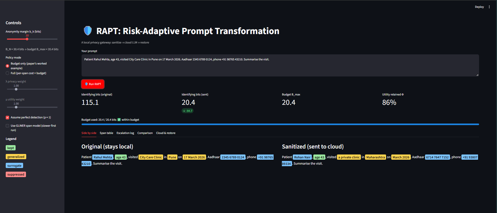
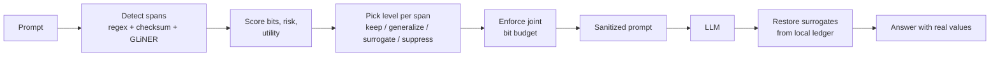

# 🛡️ RAPT: Risk-Adaptive Prompt Transformation

A local privacy gateway that sanitizes prompts **before** they reach a cloud LLM,
then restores the real values in the reply. Built for prompts containing
Indian-context identifiers (Aadhaar, PAN, GSTIN, phone, vehicle numbers).

> **Status:** working prototype of the theoretical framework in
> *"RAPT: Risk-Adaptive Prompt Transformation for Utility-Preserving Privacy
> Protection of Cloud-LLM Queries with Indian-Context Identifiers"*, with a small
> labelled evaluation and a real (local) LLM round trip. This is a demo of the
> mechanism, not a production privacy tool.



## The problem

Prompts sent to ChatGPT, Claude or Gemini often contain names, phone numbers and
government IDs. Deleting everything protects privacy but destroys the context the
LLM needs. Leaving everything exposes the person. RAPT decides, **per detail**,
how much to disguise, using a measurable privacy budget.

## How it works



**Core ideas**

- **Identifying bits:** each detail narrows down who someone is. Name ≈ 18 bits,
  city ≈ 10, Aadhaar ≈ 30.4 (log₂ of 1.4 billion). Bits add up, so several weak
  details can identify someone together.
- **Joint budget:** total leftover bits must stay under `B_N − b_k`
  (default 30.4 − 10 = 20.4), so at least ~1,024 people still match.
- **Four-level ladder:** KEEP → GENERALIZE (Pune → Maharashtra) → SURROGATE
  (Rahul Mehta → Priya Bose) → SUPPRESS. Direct identifiers can only be
  surrogated or suppressed.
- **Noisy-OR risk** from sensitivity, identifiability and contextual exposure.
- **Greedy budget loop:** escalate the span that saves the most bits per unit of
  utility lost.
- **Keyed surrogates:** HMAC-SHA256 seeded, format-preserving. Fake Aadhaar
  numbers deliberately fail the Verhoeff checksum.
- **Ledger and restore:** a local, in-memory map from fake to real values, never
  sent to the LLM.

## Reproducing the paper's worked example

Input: *"Patient Rahul Mehta, age 43, visited City Care Clinic in Pune on
17 March 2026. Aadhaar ..., phone +91 ... Summarise the visit."*

| Step | Move | Bits after |
|---|---|---|
| 0 | Aadhaar + phone → surrogate (forced) | 54.3 |
| 1 | Name → surrogate | 36.3 |
| 2 | Location → state | 31.3 |
| 3 | Organization → descriptor | 25.3 |
| 4 | Date → month–year | 20.4 |

115.1 bits → 20.4 bits, with about 86% of importance-weighted utility retained.
Verified by `test_example.py`.

## Evaluation

`evaluation.py` runs RAPT on 16 hand-labelled prompts and compares three
strategies: no protection, mask-everything, and RAPT. It is also available as the
**Evaluation** tab in the UI.

| Metric (GLiNER on) | No protection | Mask everything | RAPT |
|---|---|---|---|
| Direct identifiers leaked | 100% | 0% | **0%** |
| Words of the prompt kept | 100% | 58.8% | **75.3%** |
| Avg identifying bits left (detected) | 78.6 | 0 | 16.0 |

- **Detection:** recall 98.5%, precision 97.1% with GLiNER (83.8% / 100% with
  regex only).
- **Budget compliance:** 100% of prompts, which follows from the algorithm on
  detected spans and is a sanity check, not an empirical finding.
- **Privacy–utility curve:** sweeping the anonymity margin b_k from 0 to 26
  lowers bits sent from 25.3 to 1.6 and utility from 88% to 38%.
- **Remaining leaks are mostly deliberate.** RAPT keeps quasi-identifiers (for
  example an age) when the total is already under budget. "Mask everything"
  leaks less but retains far less of the prompt.

**Caveats:** the 16 prompts are a development set written around the detector's
formats, so recall is optimistic; "mask everything" has zero model utility by
definition, so *words kept* is the fairer comparison; and words kept is only a
crude proxy for task utility.

```bash
python evaluation.py            # regex only
python evaluation.py --gliner   # with the neural span model
```

## Real LLM round trip (Ollama)

The **Cloud & restore** tab can call a local model through Ollama
(`llama3.2:3b` by default). It sends the sanitized prompt, shows the raw reply
(with surrogates), the restored reply (real values swapped back), and optionally
the answer to the original prompt as a baseline.

A local model stands in for the cloud LLM behind the same interface. Small models
vary between calls and sometimes refuse on their own; refusals appear for the
original prompt too, so they are not caused by sanitization. Restoration only
works when the model repeats a surrogate **exactly**.

```bash
ollama pull llama3.2:3b
ollama serve
```

## Quick start

```bash
git clone https://github.com/Ajinkya8472/<repo-name>.git
cd <repo-name>
pip install -r requirements.txt

python test_example.py          # should print ALL CHECKS PASSED
python -m streamlit run app.py
```

Always launch with `streamlit run app.py` (or `python -m streamlit run app.py`),
not by running the file directly. The GLiNER model (a few hundred MB) downloads
on first use and is optional. If the console prints `torchvision` errors, they
are harmless; `.streamlit/config.toml` disables the file watcher that causes them.

## Using the demo

- **b_k slider:** safety margin. Higher means a stricter budget and more disguising.
- **Policy mode:** *Budget only* reproduces the paper's example. *Full* adds the
  per-span cost minimizer, tuned by λ (privacy) and μ (utility).
- **GLiNER checkbox:** switches name, organization and location detection from
  hardcoded patterns to a neural span model.
- **LLM backend:** `mock` or `ollama`.
- **Tabs:** side-by-side view, span table, escalation log, strategy comparison,
  cloud round trip with restore, and the evaluation.

## Project structure

| File | Role |
|---|---|
| `config.py` | Bits, sensitivity priors, utility retention, ladders |
| `detector.py` | Verhoeff checksum, regex detection, overlap resolution |
| `detector_model.py` | Optional GLiNER span model |
| `scoring.py` | Bits, noisy-OR risk, utility, per-span cost |
| `policy.py` | Per-span minimizer and greedy budget loop |
| `transformer.py` | Surrogates, generalizers, ledger, restore |
| `pipeline.py` | Ties the steps together |
| `llm.py` | LLM backends (mock and Ollama) |
| `evaluation.py` | Labelled test set, baselines, metrics, b_k sweep |
| `app.py` | Streamlit UI |
| `test_example.py` | Checks the paper's worked example |

## Current limitations

- **Importance scores are fixed** to the paper's hypothetical values, not yet
  computed by leave-one-out with a sentence encoder.
- **Detection is incomplete.** No passport, bank account, UPI or medical IDs; no
  street addresses or PIN codes; limited date formats ("March 17, 2026" is
  missed); English only.
- **Undetected text counts as 0 bits**, so a prompt with unrecognized names can
  still show "within budget". The budget is only as good as the detector.
- **No coreference:** "Sneha" and "Sneha Kulkarni" receive different surrogates.
- **No output validation** of the LLM reply yet.
- **Bit values are design priors** that assume independence between attributes.
- **Small evaluation set**, developed alongside the detector.
- **No formal guarantee.** This is not differential privacy, formal anonymity,
  or legal compliance (including DPDP Act compliance).

## Roadmap

- [ ] Leave-one-out importance with MiniLM, plus a task-conditional box
- [ ] Output validation (injection and leak scanning)
- [ ] More Indian ID validators, date formats, address and PIN generalization
- [ ] Name coreference within a prompt
- [ ] Romanized-Hindi normalization and multilingual detection
- [ ] Evaluation on held-out prompts and real LLM answer-quality comparison
- [ ] Exact DP solver (Proposition 8) as a reference for the greedy loop

## Team

Sumit Hirve, Arpit Nainwal, Agam Kadakia, Ajinkya Deshmukh
MIT School of Computing, MIT ADT University, Pune

## License

MIT (see `LICENSE`)
