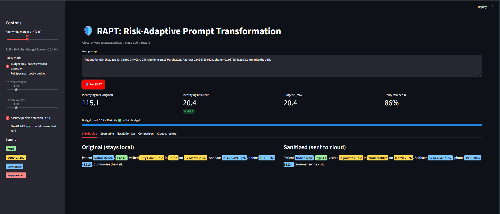
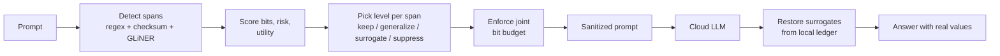
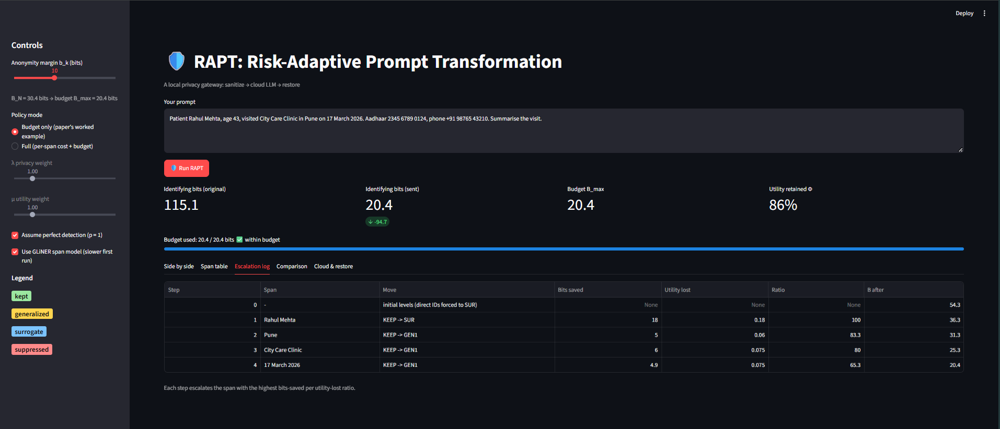
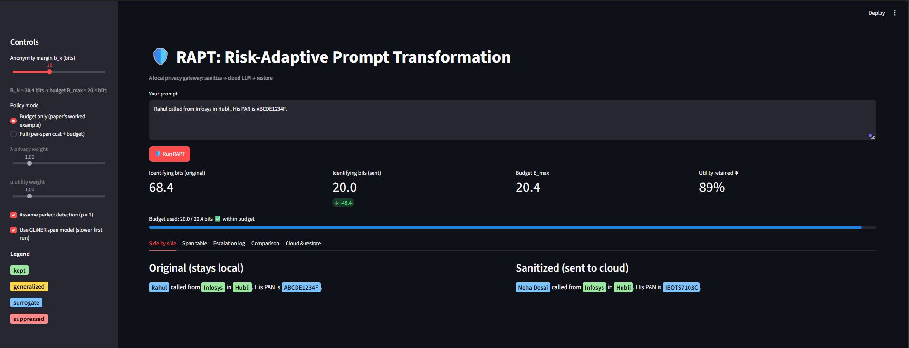

# 🛡️ RAPT: Risk-Adaptive Prompt Transformation

A local privacy gateway that sanitizes prompts **before** they reach a cloud LLM,
then restores the real values in the reply. Built for prompts containing
Indian-context identifiers (Aadhaar, PAN, GSTIN, phone, vehicle numbers).

> **Status:** working prototype of the theoretical framework in
> *"RAPT: Risk-Adaptive Prompt Transformation for Utility-Preserving Privacy
> Protection of Cloud-LLM Queries with Indian-Context Identifiers"*.
> This is a demo of the mechanism, not a production privacy tool.



## The problem

Prompts sent to ChatGPT, Claude or Gemini often contain names, phone numbers and
government IDs. Deleting everything protects privacy but destroys the context the
LLM needs. Leaving everything exposes the person. RAPT decides, **per detail**,
how much to disguise, using a measurable privacy budget.

## How it works



**Core ideas**

- **Identifying bits:** each detail narrows down who someone is. Name ≈ 18 bits,
  city ≈ 10, Aadhaar ≈ 30.4 (log₂ of 1.4 billion). Bits add up, so several weak
  details can identify someone together.
- **Joint budget:** total leftover bits must stay under `B_N − b_k`
  (default 30.4 − 10 = 20.4), so at least ~1,024 people still match.
- **Four-level ladder:** KEEP → GENERALIZE (Pune → Maharashtra) → SURROGATE
  (Rahul Mehta → Priya Bose) → SUPPRESS. Direct identifiers can only be
  surrogated or suppressed.
- **Noisy-OR risk** from sensitivity, identifiability and contextual exposure.
- **Greedy budget loop:** escalate the span that saves the most bits per unit of
  utility lost.
- **Keyed surrogates:** HMAC-SHA256 seeded, format-preserving. Fake Aadhaar
  numbers deliberately fail the Verhoeff checksum.
- **Ledger and restore:** a local, in-memory map from fake to real values, never
  sent to the cloud.

## Reproducing the paper's worked example

Input: *"Patient Rahul Mehta, age 43, visited City Care Clinic in Pune on
17 March 2026. Aadhaar ..., phone +91 ... Summarise the visit."*

| Step | Move | Bits after |
|---|---|---|
| 0 | Aadhaar + phone → surrogate (forced) | 54.3 |
| 1 | Name → surrogate | 36.3 |
| 2 | Location → state | 31.3 |
| 3 | Organization → descriptor | 25.3 |
| 4 | Date → month–year | 20.4 |

115.1 bits → 20.4 bits, with about 86% of importance-weighted utility retained.
Verified by `test_example.py`.

## Quick start

```bash
git clone https://github.com/<your-username>/rapt.git
cd rapt
python -m venv .venv
.venv\Scripts\activate          # Windows  (macOS/Linux: source .venv/bin/activate)
pip install -r requirements.txt

python test_example.py          # should print ALL CHECKS PASSED
streamlit run app.py
```

Always launch with `streamlit run app.py`, not by running the file directly.
The GLiNER model (a few hundred MB) downloads on first use and is optional.

## Using the demo

- **b_k slider:** safety margin. Higher means a stricter budget and more disguising.
- **Policy mode:** *Budget only* reproduces the paper's example. *Full* adds the
  per-span cost minimizer, tuned by λ (privacy) and μ (utility).
- **GLiNER checkbox:** switches name, organization and location detection from
  hardcoded patterns to a neural span model.
- **Tabs:** side-by-side view, span table, escalation log, strategy comparison,
  and the cloud round trip with restore.

## Project structure

| File | Role |
|---|---|
| `config.py` | Bits, sensitivity priors, utility retention, ladders |
| `detector.py` | Verhoeff checksum, regex detection, overlap resolution |
| `detector_model.py` | Optional GLiNER span model |
| `scoring.py` | Bits, noisy-OR risk, utility, per-span cost |
| `policy.py` | Per-span minimizer and greedy budget loop |
| `transformer.py` | Surrogates, generalizers, ledger, restore |
| `pipeline.py` | Ties the steps together |
| `llm.py` | LLM backend (currently a mock) |
| `app.py` | Streamlit UI |
| `test_example.py` | Checks the paper's worked example |

## Current limitations

- **The LLM is mocked.** The round trip works, but no real model answers yet.
- **Importance scores are fixed** to the paper's hypothetical values, not yet
  computed by leave-one-out with a sentence encoder.
- **Detection is incomplete.** No passport, bank account, UPI or medical IDs; no
  street addresses or PIN codes; limited date formats; English only.
- **Undetected text counts as 0 bits**, so a prompt with unrecognized names can
  still show "within budget". The budget is only as good as the detector.
- **Bit values are design priors** that assume independence between attributes.
- **No formal guarantee.** This is not differential privacy, formal
  anonymity, or legal compliance (including DPDP Act compliance).

## Roadmap

- [ ] Leave-one-out importance with MiniLM, plus a task-conditional box
- [ ] Real LLM backend (API or Ollama)
- [ ] Output validation (injection and leak scanning)
- [ ] More Indian ID validators and address / PIN generalization
- [ ] Romanized-Hindi normalization and multilingual detection
- [ ] Exact DP solver (Proposition 8) as a reference for the greedy loop

## Team

Sumit Hirve, Arpit Nainwal, Agam Kadakia, Ajinkya Deshmukh
MIT School of Computing, MIT ADT University, Pune



